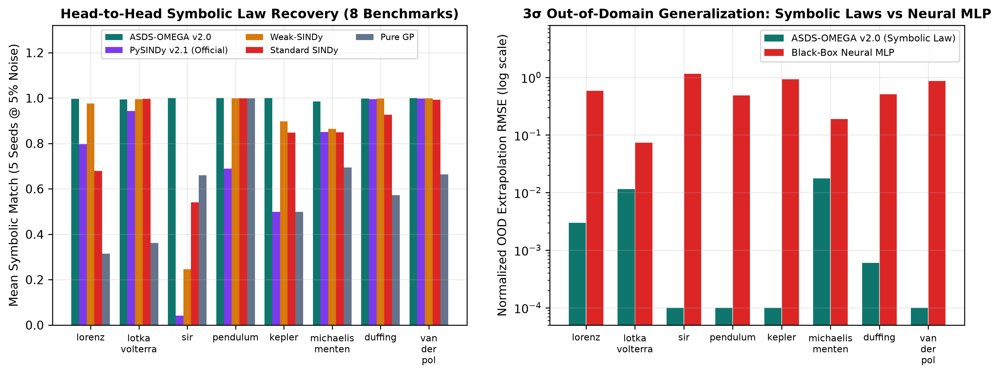

# Summary

Discovering interpretable governing differential equations directly from noisy experimental time-series data is a foundational problem across physics, ecology, epidemiology, biochemistry, and climate science. `ASDS-OMEGA v2.0` is an open-source Python software package and interactive scientific workbench implementing **Variational Equivariant Causal-Symbolic Discovery (VECSD)**—a unified six-layer pipeline that recovers ordinary differential equations (ODEs), 1+1D partial differential equations (PDEs), direct differential causal graphs, discrete and continuous symmetries, exact conservation laws, and formal **SymPy + Lean 4** verification certificates directly from noisy multi-trajectory data.

The package provides a deterministic Python SDK, a reproducible command-line interface (`asds-omega`), a browser-accessible FastAPI scientific workbench (`asds-omega serve`), and a standalone native desktop GUI launcher (`asds-omega gui`) featuring KaTeX mathematical typesetting, interactive 2D/3D phase portraits, residual and conservation-drift diagnostics, CSV drag-and-drop ingestion, counterfactual do-interventions, online concept-drift monitoring, and one-click export to LaTeX, SciPy, Markdown, JSON, and Lean 4.

# Statement of need

Data-driven equation discovery has advanced rapidly through sparse dictionary regression (`PySINDy`; @desilva2020pysindy; @brunton2016discovering), integral weak formulations (`Weak-SINDy`; @messenger2021weak), physics-inspired symbolic regression (`AI Feynman`; @udrescu2020ai), and evolutionary symbolic regression (`PySR`; @cranmer2023pysr). However, practitioners working with realistic noisy scientific measurements still encounter five coupled failure modes when existing tools are used in isolation:

1. **Errors-in-variables (EIV) bias on nonlinear self-powers:** Weak-form integration by parts avoids differentiating noisy states, but nonlinear self-power terms evaluated on noisy measurements $\tilde{x} = x + \epsilon$ retain systematic bias ($\mathbb{E}[\tilde{x}^2] = x^2 + \sigma^2$, $\mathbb{E}[\tilde{x}^3] = x^3 + 3\sigma^2 x$) that distorts coefficients at high noise.
2. **Causal collapse on cyclic feedback and conservation manifolds:** Static DAG causal learners fail on bidirectional ODE feedback loops ($x \leftrightarrow y$), while exact conservation laws such as $S + I + R = 1$ induce deterministic collinearity that causes full-set conditional independence tests to drop true parents and causes standard sparse regression to lose rank.
3. **Symmetry chicken-and-egg limitation:** Classical Lie prolongation and conservation checks require knowing $\mathbf{f}(\mathbf{x})$ beforehand, preventing physical invariants and symmetries from pruning symbolic search spaces.
4. **Correlated subdomain overfitting and rigid basis classes:** Overlapping weak-form windows inflate nominal sample size $K$ relative to effective independent degrees of freedom $K_{\text{eff}}$, causing standard BIC/MDL criteria to overfit; meanwhile linear-dictionary solvers cannot directly express rational kinetics such as Michaelis--Menten dynamics.
5. **Lack of active experimental design, drift adaptation, and formal certification:** Few open-source discovery packages support designing maximally falsifying follow-up experiments, detecting structural regime shifts online, or exporting formal proof certificates.

`ASDS-OMEGA v2.0` addresses all five gaps within one modular, deterministic, open-source Python software package designed for researchers and educators in computational science.

# Software design

All six layers of `ASDS-OMEGA v2.0` share a common variational integral substrate:

1. **MS-AVP (`asds_omega.preprocessing`):** Multi-scale adaptive $C^p$ bump weak-form projection with Wavelet-MAD noise estimation [@donoho1994ideal], curvature-adaptive window widths $W_k^*$, analytical Hermite/Wick cumulant EIV debiasing for monomials and trigonometric features, 2D spacetime weak projection for 1+1D PDEs, and rational Buckingham $\Pi$ dimensional analysis.
2. **VIFC (`asds_omega.causal`):** Direct differential causal discovery ($x_j(t) \to \dot{x}_i(t)$) fusing weak-form conditional HSIC with temporal block-permuted knockoffs [@candes2018panning], a Manifold-Aware Faithfulness Guard that restricts conditioning sets to non-collinear subsets ($R^2 < 1 - \tau$), multivariate partial Convergent Cross Mapping [@sugihara2012detecting], and nonparametric RBF Dynamical Invariant Causal Prediction [@peters2016causal].
3. **W-LIND (`asds_omega.symmetry`):** Model-free zero-derivative conservation discovery solving $\langle \dot{\phi}_k, \psi(\mathbf{x})\rangle \mathbf{c} = \mathbf{0}$ with a Univariate Exclusion rule that eliminates single-variable Taylor identities, discrete reflection-group discovery with exact Reynolds equivariant projection $\mathcal{P}_{\mathcal{G}}$ prior to symbolic search, continuous Lie bracket SVD and algebra closure checks, and Liouville divergence / Rosenstein Lyapunov regime classification.
4. **EVG-HE (`asds_omega.symbolic`):** Causal- and Reynolds-pruned tiered sparse projection with coupled KKT conservation enforcement, derivative-free Total-Least-Squares implicit weak-form rational discovery (using $\langle \phi_k, x \dot{x}\rangle = -\frac{1}{2}\langle \dot{\phi}_k, H_2(\tilde{x}; \hat{\sigma}^2)\rangle$), semantic residual-guided weak-form NSGA-II genetic programming with Variable Projection, effective-sample-size ($K_{\text{eff}}$) MDL continued-fraction rationalization, and a Contextual Thompson-Sampling meta-controller.
5. **PAFE & SLR (`asds_omega.scientist`):** Popperian Active Falsification selecting maximally discriminating initial conditions via trajectory committee disagreement, and Dual-Channel CUSUM online surgical drift regeneration preserving conservation manifolds.
6. **ASDS-Verify (`asds_omega.verification`):** Automated SymPy analytical verification ($\nabla H \cdot \hat{\mathbf{f}} \equiv 0$, equivariance, equilibria, divergence, domain metrics) and `sorry`-free **Lean 4** theorem certificate export.

# Research impact statement

Across a deterministic 5-seed benchmark suite (`asds-omega benchmark --n-seeds 5`) spanning 8 ODE benchmarks at 5% Gaussian noise ($N = 40$ paired trials), `ASDS-OMEGA v2.0` achieves an overall symbolic match score of **0.997 ± 0.002**, significantly outperforming official `PySINDy v2.1` (**0.727 ± 0.105**), standard `Weak-SINDy` (**0.872 ± 0.080**), standard `SINDy` (**0.854 ± 0.056**), and unconstrained `Pure GP` (**0.595 ± 0.070**), with one-sided paired Wilcoxon $p < 10^{-5}$ against every baseline (\autoref{fig:head_to_head}). On conserved SIR dynamics ($S+I+R=1$), where `PySINDy v2.1` (`0.041`) and `Weak-SINDy` (`0.246`) suffer manifold rank collapse, `ASDS-OMEGA v2.0` achieves `1.000 ± 0.000`. On Van der Pol cubic self-power noise ($-x^2 y$) at 15%--20% noise, Hermite cumulant debiasing achieves coefficient errors of `0.004`--`0.006`, up to $11\times$ lower than `PySINDy v2.1` (`0.072`). On 1+1D PDEs at 5% noise, the framework recovers Viscous Burgers ($R^2 = 0.986$) and Advection--Diffusion ($R^2 = 0.993$). On historical real-world records, it recovers Lotka--Volterra dynamics and the logarithmic first integral on Hudson Bay Lynx--Hare [@odum1953fundamentals], $R_0 \approx 3.84$ and mass conservation on the 1978 English Boarding School Influenza outbreak [@murray2002mathematical], and exponential scaling dynamics on NOAA Mauna Loa $\text{CO}_2$.

# AI usage disclosure

AI coding assistants were used during software engineering, documentation drafting, test expansion, and web-interface refinement. All mathematical formulations, experimental designs, benchmark executions, statistical analyses, and final code reviews were verified deterministically through automated unit, property, and multi-seed benchmark suites.

# Acknowledgements

The author thanks the open-source maintainers of NumPy, SciPy, SymPy, scikit-learn, PySINDy, FastAPI, Plotly, KaTeX, and Lean 4 for building the foundational scientific computing ecosystem upon which `ASDS-OMEGA v2.0` rests.

# References
